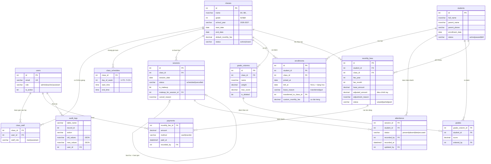

# Thiết kế Database — Hệ thống Quản lý Lớp Học Thêm

> File đi kèm: `schema.sqlserver.sql` (dùng ngay để test), `schema.postgres.sql` (dùng khi migrate Supabase), `seed.sql` (dữ liệu mẫu).
> Tổng: **13 bảng**.

## 1. Sơ đồ ERD



## 2. Các quyết định thiết kế chính

| # | Quyết định | Lý do |
|---|---|---|
| 1 | **Không có bảng môn học** | SRS: chỉ 1 môn duy nhất. Thêm sẽ là over-engineering; nếu Phase 2 cần thì thêm bảng `subjects` + cột `subject_id` vào `classes` sau. |
| 2 | **`class_staff` tách riêng, 1 GV chính enforce bằng filtered unique index** | `ux_class_staff_one_main ON class_staff(class_id) WHERE staff_role='main'` — DB tự chặn lớp có 2 GV chính; trợ giảng thì bao nhiêu cũng được. Cú pháp filtered index (SQL Server) = partial index (Postgres), migrate thẳng. |
| 3 | **`enrollments` là bảng lịch sử, không phải quan hệ tĩnh** | Chuyển lớp = set `left_at` + `leave_reason='transferred'` + `transferred_to_class_id` trên dòng cũ, tạo dòng mới. Mọi dữ liệu điểm/điểm danh/phí gắn với lớp cũ **không đụng tới** → giữ nguyên lịch sử (FR-3.4). Index `ux_enrollments_active` (WHERE left_at IS NULL) chặn 1 HS học 2 lớp cùng lúc. |
| 4 | **Khóa điểm danh 24h enforce ở tầng app, không phải DB** | Rule "sau 24h chỉ admin sửa" phụ thuộc *vai trò người gọi* — DB thuần không biết ai đang gọi. Schema cung cấp đủ dữ liệu: `sessions.session_date + start_time` để tính hạn, `recorded_by/recorded_at/updated_by/updated_at` để audit. Backend so giờ và check role. |
| 5 | **Điểm TB trọng số tính bằng query, không lưu sẵn** | Quy mô ≤1000 HS thì `SUM(score/max_score*10*weight)/SUM(weight)` tính realtime thoải mái, tránh bài toán cache invalidation khi sửa điểm/trọng số. |
| 6 | **`monthly_fees` (khoản phải thu) tách khỏi `payments` (lần đóng)** | 1 khoản phí có nhiều lần đóng (đóng thiếu/thừa — FR-6.4). Số phải đóng = `COALESCE(adjusted_amount, base_amount)`; trạng thái `unpaid/partial/paid` do app cập nhật sau mỗi payment. Trợ giảng ghi payment được nhưng **không xem doanh thu** — chặn ở tầng API (FR-6.5), dữ liệu vẫn chung bảng. |
| 7 | **Điều chỉnh phí là thao tác tay có audit** | Đúng yêu cầu "phí tháng cố định, trừ tay khi hủy buổi": `adjusted_amount + adjustment_reason + adjusted_by`. Hệ thống KHÔNG tự trừ. |
| 8 | **Buổi bù là dòng `sessions` mới với `is_makeup=1` + FK `makeup_for_session_id`** | Buổi hủy giữ nguyên dòng (status='cancelled' + lý do) để còn thống kê "tháng này hủy mấy buổi"; buổi bù điểm danh như buổi thường. |
| 9 | **Soft delete / trạng thái thay vì xóa cứng** (NFR-3) | `users.is_active`, `students.status`, `classes.status`, `grade_columns.is_deleted`. Riêng dữ liệu giao dịch (attendance, grades, payments) không bao giờ xóa — chỉ sửa có audit. |
| 10 | **`audit_logs` dạng generic (table_name + record_id + JSON old/new)** | Một bảng phủ mọi thao tác nhạy cảm (NFR-4): sửa điểm danh sau 24h, điều chỉnh phí, chuyển lớp, sửa điểm. Ghi từ backend, không dùng trigger (trigger 2 dialect viết 2 kiểu — khó migrate). |
| 11 | **PK dùng INT IDENTITY thay vì UUID** | Đơn giản, đủ cho 1 trung tâm, migrate identity sang Postgres `GENERATED ALWAYS AS IDENTITY` là chuẩn SQL. Nếu sau này cần sync đa nguồn mới phải nghĩ tới UUID. |
| 12 | **Tiền dùng `DECIMAL(12,0)`** | VND không có số lẻ; 12 chữ số = tới 999 tỷ, quá đủ. |

## 3. Mapping SRS → bảng

| Yêu cầu | Bảng/cột đáp ứng |
|---|---|
| FR-1 Tài khoản, vai trò, vô hiệu hóa | `users` (role, is_active, password_hash) |
| FR-2.1–2.2 Lớp + gán GV/trợ giảng | `classes`, `class_staff` |
| FR-2.3 Khung giờ tuần → sinh buổi | `class_schedules` → `sessions` |
| FR-2.4 Hủy buổi / buổi bù | `sessions.status/cancel_reason/is_makeup/makeup_for_session_id` |
| FR-3.1–3.3 Hồ sơ HS | `students` (đủ các trường SRS yêu cầu) |
| FR-3.4 Chuyển lớp giữ lịch sử | `enrollments` (left_at, leave_reason, transferred_to_class_id, created_by) |
| FR-4 Điểm danh 4 trạng thái, khóa 24h, audit | `attendance` (status CHECK 4 giá trị, recorded_*/updated_*) + rule ở app |
| FR-5 Cột điểm + trọng số + TB | `grade_columns` (weight, max_score), `grades` |
| FR-6.1 Phí cố định + ghi đè từng HS | `classes.default_monthly_fee`, `enrollments.custom_monthly_fee` |
| FR-6.2–6.3 Khoản phí tháng + điều chỉnh tay | `monthly_fees` (base/adjusted_amount, adjustment_reason, status) |
| FR-6.4 Lần đóng: ngày giờ, người ghi, số tiền, hình thức, ghi chú | `payments` (đủ 5 cột tương ứng) |
| FR-6.5 Trợ giảng không xem doanh thu | Phân quyền tầng API (dữ liệu không cần tách) |
| FR-7 Báo cáo | Query trên attendance / grades / monthly_fees+payments / enrollments (xem mục 5) |
| NFR-3 Không xóa cứng | Các cột status/is_active/is_deleted |
| NFR-4 Audit | `audit_logs` + các cột recorded_by/entered_by/adjusted_by/created_by |
| NFR-5 Tương thích 2 DB | Xem mục 6 |
| NFR-7 UTC | Mọi datetime là DATETIME2/timestamptz lưu UTC |

## 4. Bốn câu hỏi mở (SRS mục 7) — schema xử lý thế nào

Schema **không khóa cứng** lựa chọn nào, chốt nghiệp vụ sau không phải sửa bảng:

1. **Phí sinh tự động hay chốt tay?** — `monthly_fees` chỉ là dữ liệu; sinh bằng cron đầu tháng hay nút "chốt phí" đều là code backend. UNIQUE (student, class, year, month) chặn sinh trùng ở cả 2 cách.
2. **HS tạm nghỉ giữa tháng?** — dùng chính cơ chế `adjusted_amount + adjustment_reason` (điều chỉnh tay, có lưu vết), hoặc không sinh phí tháng sau khi `students.status='paused'`.
3. **Năm học từ tháng mấy?** — `classes.start_date/end_date` là DATE tự do, không giả định tháng nào.
4. **In phiếu thu?** — `payments` đã đủ dữ liệu in (số tiền, ngày giờ, hình thức, người thu, khoản phí tháng nào của HS nào). Phase sau chỉ cần làm UI/PDF.

## 5. Query báo cáo mẫu (FR-7)

```sql
-- 5.1 Chuyên cần theo lớp trong khoảng thời gian
SELECT st.id, st.full_name,
       COUNT(*)                                             AS total_sessions,
       SUM(CASE WHEN a.status = 'present' THEN 1 ELSE 0 END) AS present,
       SUM(CASE WHEN a.status = 'absent'  THEN 1 ELSE 0 END) AS absent,
       SUM(CASE WHEN a.status = 'late'    THEN 1 ELSE 0 END) AS late,
       SUM(CASE WHEN a.status = 'excused' THEN 1 ELSE 0 END) AS excused
FROM attendance a
JOIN sessions s  ON s.id = a.session_id
JOIN students st ON st.id = a.student_id
WHERE s.class_id = @class_id
  AND s.session_date BETWEEN @from_date AND @to_date
GROUP BY st.id, st.full_name;

-- 5.2 Bảng điểm TB trọng số của lớp (điểm quy về thang 10)
SELECT st.id, st.full_name,
       ROUND(SUM(g.score / gc.max_score * 10 * gc.weight) / SUM(gc.weight), 2) AS avg_score
FROM grades g
JOIN grade_columns gc ON gc.id = g.grade_column_id AND gc.is_deleted = 0
JOIN students st      ON st.id = g.student_id
WHERE gc.class_id = @class_id
GROUP BY st.id, st.full_name;

-- 5.3 Công nợ học phí của lớp theo tháng
SELECT st.full_name, mf.status,
       COALESCE(mf.adjusted_amount, mf.base_amount)          AS amount_due,
       COALESCE((SELECT SUM(p.amount) FROM payments p
                 WHERE p.monthly_fee_id = mf.id), 0)         AS amount_paid
FROM monthly_fees mf
JOIN students st ON st.id = mf.student_id
WHERE mf.class_id = @class_id AND mf.fee_year = @y AND mf.fee_month = @m;

-- 5.4 Doanh thu tháng theo lớp (admin: bỏ WHERE class_id để xem toàn trung tâm)
SELECT mf.class_id, SUM(p.amount) AS revenue
FROM payments p
JOIN monthly_fees mf ON mf.id = p.monthly_fee_id
WHERE mf.fee_year = @y AND mf.fee_month = @m
GROUP BY mf.class_id;
```

## 6. Ghi chú migrate SQL Server → Supabase (Postgres)

| SQL Server | Postgres | Ghi chú |
|---|---|---|
| `INT IDENTITY(1,1)` | `integer GENERATED ALWAYS AS IDENTITY` | Chuẩn SQL, ORM (Prisma/Knex) tự xử lý |
| `BIT` (1/0) | `boolean` (true/false) | Chú ý code so sánh `= 1` phải đổi thành `= true` — nên để ORM lo |
| `NVARCHAR(n)` / `NVARCHAR(MAX)` | `varchar(n)` / `text` | Postgres mặc định UTF-8, không cần N-prefix |
| `DATETIME2` + `SYSUTCDATETIME()` | `timestamptz` + `now()` | Cả hai lưu UTC; app luôn gửi/nhận UTC, format giờ VN ở frontend |
| `DECIMAL` | `numeric` | Tương đương |
| Filtered index `WHERE ...` | Partial index `WHERE ...` | Cùng cú pháp — 2 index unique quan trọng migrate nguyên vẹn |
| `GETUTCDATE()`/`SYSUTCDATETIME()` trong seed | `now()` | Chỉ khác tên hàm |

**Khuyến nghị backend:** dùng **Prisma** hoặc **Knex** ngay từ đầu — cả hai hỗ trợ SQL Server lẫn Postgres, lúc migrate gần như chỉ đổi connection string + chạy lại migration. Tránh viết raw query dính dialect (TOP n → LIMIT, GETUTCDATE...).

**Lưu ý riêng cho Supabase:** Supabase mặc định bật Row Level Security trên các bảng tạo qua dashboard; vì backend Node vẫn là tầng duy nhất truy cập DB (qua connection string), có thể tắt RLS hoặc dùng service role key. Nếu Phase 2 muốn client gọi thẳng Supabase thì lúc đó mới viết RLS policy theo `class_staff`.
